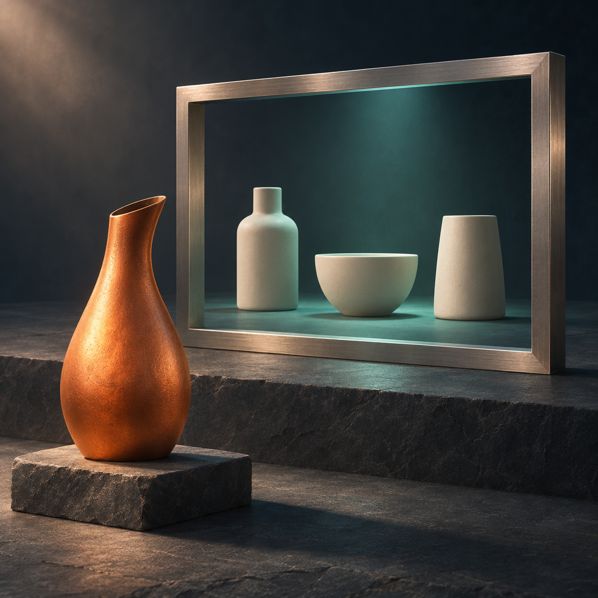

# 示例：被看见，却没有进入候选

## 输入

给一条商业观点配图：一个产品被很多人看见，却没有进入购买时的候选名单。适合朋友圈，方图，无字，质感克制。

## 视觉方案

把“进入候选”表现为一个有明确边界的筛选场景。几件中性产品已经处于筛选框内，一个更精致、清晰可见的产品仍停留在边界外。观众能够同时看见它的存在与被排除的处境。

## 最终提示词

```text
Use case: stylized-concept, ads-marketing.
Asset type: square 1:1 editorial image for a business social post, no text.
Core message: visibility alone does not put a product on a buyer's shortlist.

Create a premium 3D editorial still life, photographed like a cinematic design campaign. A large upright, precisely machined brushed-metal rectangular selection frame defines a spatial threshold on a charcoal stone stage. Inside the frame, three modest ivory ceramic product forms stand together in a quiet row, illuminated by a restrained pale teal selection light. Just outside the frame in the foreground stands one beautifully crafted, anonymous warm copper-orange product form on its own small stone base. It is prominent and completely visible, but clearly outside the same selection boundary. All objects are unbranded, abstract physical product sculptures, not app icons or interface cards. The relationship must communicate exclusion from a shortlist without any arrows, words, UI, or numerical indicators.

Composition: one coherent scene with a clear focal point on the excluded foreground object; the frame and selected forms remain readable; three-quarter camera, moderate depth of field, generous negative space and precise spacing. No collage or before-and-after split.
Materials: honed charcoal stone, satin brushed metal, matte ivory ceramic, finely textured warm copper. Realistic weight, contact shadows, restrained reflections, tiny tactile imperfections.
Lighting: soft cinematic key light from upper left, subtle rim light, deep but readable navy shadows. Warm neutral highlights. Orange-copper is the focal accent; pale teal is limited to the interior selection light. Sophisticated, quiet, credible, editorial.
Text: no text, no letters, no labels.
Avoid: logos, watermarks, people, office furniture, cute emoji, dashboards, floating information cards, generic tech grids, neon haze, shiny plastic, excessive glow, clutter, invented rankings or results.
```

## 生成结果



此图为生成式概念插画，用于展示视觉方法，不代表真实品牌、产品或经营结果。
